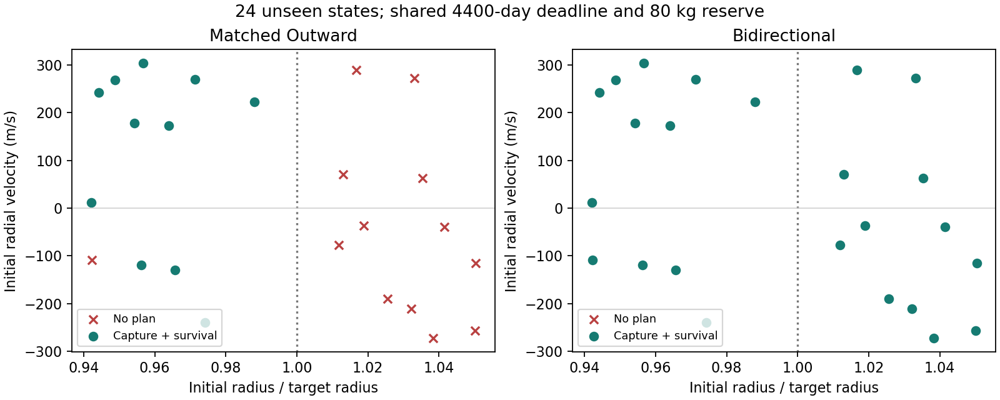

# Spacecraft AI Controller

A research sandbox for **recoverable orbital insertion in simplified 2D dynamics**. I study how trajectory planning, state estimation and explicit feedback control turn a target-radius crossing into a near-circular state that survives the declared simulation checks. The latest work adds fuel-constrained transfer search and fault-aware navigation. This is simulation research, with separate historical and development models; it is not flight-qualified spacecraft GNC.

**Evidence snapshot:** October 23, 2026 · [source commit `ff4d062`](https://github.com/Sean-ZhiXin-Li/spacecraft-ai-controller/commit/ff4d06229016511d38bba2c432b990e0c38be001) · documentation audited November 2026.

[Current evidence](#current-evidence) · [Methods](#how-the-current-prototype-works) · [Research evolution](#research-evolution) · [Reproduce](#reproduce-and-check) · [Limitations](#limitations-and-open-questions) · [Long-term vision](#long-term-vision)



*Existing, data-backed holdout figure: the same 24 starting states, a shared 4,400-day deadline, 110 kg planning reserve and 80 kg operational reserve. Each marker is one task; crosses are retained no-plan cases. This shows coverage of the tested geometry, not trajectories or a general success probability. [Raw records](development_results/multiregime_transfer_2026-10-23_holdout/runs.jsonl) · [Configuration](development_results/multiregime_transfer_2026-10-23_holdout/configuration.json) · [Provenance and media audit](docs/readme_evidence.md#media-audit)*

## Current evidence

The October studies are **explicit, model-based development prototypes**, not learned policies. Each row has its own matched comparison; counts across rows must not be pooled. Capture and sampled survival are simulator-specific labels.

| Study | Matched reference → new method | What the recorded experiment establishes |
|---|---|---|
| [Bidirectional transfer](project_log/2026-10-23_multiregime_transfer_planning.md) | **11/24 → 24/24** capture and sampled survival | Matched outward-only vs inward/outward intersection prediction, with shared search, resources and 4,400-day horizon. Seeds 1201–1224; 12 interior and 12 exterior starts. |
| [Asynchronous faults v4](project_log/2026-10-23_asynchronous_fault_dev_v4.md) | **14/30 → 30/30** capture on actually exposed conditions | Quarantining contaminated coast fits improves terminal estimation. Full set: 20/36 → 36/36; six pairs completed before fault onset. Twelve seeds, three related fault classes per seed. |
| [Position-confirmed diagnosis v3](project_log/2026-10-23_fault_aware_transfer_dev_v3.md) | **12/36 → 36/36** capture | Position evidence separates sensor jumps from physical impulses after a delay under the tested synchronous fault model. Twelve seeds × three conditions; all improved captures pass sampled survival. |
| [Bias-rate estimation v2](project_log/2026-10-23_position_aided_capture_dev_v2.md) | **8/24 → 24/24** capture and sampled survival | Static-bias estimate vs temporal bias-rate tracking on twelve unseen seeds × two drift rates. Shared two-body model and exact mass telemetry remain assumptions. |
| [Fuel-aware control v1, revision 5](development_results/closed_loop_transfer_v1_2026-10-23_revision5/summary.json) | **22/24 → 22/24** capture and sampled survival | The stronger fixed-departure comparison finds no capture-rate gain from feedback. Fuel-limited cases 43/44 remain unresolved. Earlier revision-3 gains also changed departure planning/reserve use. |

**Negative evidence is part of the result.** At the original 1,100-day deadline, all three multiregime planners returned no plan on all eight development tasks and executed no mission trajectories. Extending the deadline to 4,400 days was a **new comparison contract**: bidirectional capture was 7/8 in development and 24/24 on the separate holdout. Development seed 1104 still returns no plan at 4,400 days. A longer-deadline diagnostic candidate was not executed or counted as success. `no_plan` means this finite search found no candidate; it does not prove physical infeasibility.

The historical legacy planner achieved 1/24 on the new holdout, but retains an internal 2,000-day prediction cutoff and different search details. **11/24 matched outward vs 24/24 bidirectional is the primary geometry comparison.** Eleven common captures have essentially unchanged execution outcomes; the demonstrated gain is expanded coverage, not a faster controller or improved execution on already supported arcs.

For the fault studies, multiple conditions share a seed and are not independent trials. Neither v3 nor v4 needed a cruise correction in its final holdout: these gains support estimator recovery and evidence handling, not a demonstrated holdout replanning advantage. Full configurations, negative runs, source snapshots and quantitative caveats are linked in the [evidence guide](docs/readme_evidence.md).

## How the current prototype works

The October development track uses solar two-body gravity and Cartesian state `[x, y, vx, vy, mass]`. The nominal target radius is `7.5e12 m`; wet/dry masses are 722/300 kg. A constrained, finite multi-start optimizer searches departure radial/tangential impulses and predicts target-radius intersections. Independent finite-duration burns replay departure and capture with variable mass, nominal 2,000 N thrust and measurement-based guidance.

The latest planner considers future inward and outward elliptic intersections. Navigation variants estimate velocity bias from position evolution, retain useful drift information after a detected jump, and exclude a suspect coast interval from bias history until clean position evidence is available. Injected fault labels and true state belong to the plant/scoring side, not the estimator's inputs.

```text
measurement → state/bias estimate → constrained transfer prediction/search
            → finite-burn guidance → simulated plant → new measurement
                                           ↓
                              separate truth-based evaluation
```

In the latest multiregime experiment, capture requires converged guidance, eccentricity `< 0.001`, relative radius error `≤ 0.0025`, and completion within the declared deadline. Survival checks relative radius error at 101 samples over the following 100 unpowered days. These sampled checks are not a continuous-time safety proof. Earlier v2–v4 implementations use the same geometry/guidance thresholds but do not enforce the deadline in the final capture predicate; their recorded successful runs finish before 1,100 days. See the [exact contracts](docs/readme_evidence.md#model-and-evaluation-boundaries).

## Research evolution

**First crossing is not orbital insertion.** A geometric crossing can still carry radial and tangential errors that the available controller cannot recover. This timeline follows the research sequence; the phase labels are historical experiment families, not increasing levels of flight readiness.

| Research step | What changed or remained unresolved | Representative evidence |
|---|---|---|
| Early PPO → imitation learning | The tested policies did not reproduce the explicit controller's useful phase structure. This is a negative result for those experiments, not a general limit of RL. | [Transfer results](analysis/ppo_transfer_results.md) |
| Phases 31–34 → post-cross synchronization | SciPy direct shooting exposed a useful motif, then an explicit controller implemented it. In 24 reduced-grid cases, recoverable crossings changed **0 → 8**; both arms still had eight crossings and eight simulator success labels. | [Structure extraction](analysis/phase33_optimal_structure_extraction/structure_decomposition.md) · [Phase34 comparison](analysis/phase34_post_cross_sync/phase34_vs_phase31_comparison.md) |
| Phases 36–37 → upstream geometry | Tested transfer families and local perturbations did not resolve the historical noncrossing cases. Phase37B also failed preservation checks. | [Noncrossing diagnosis](analysis/phase36c_non_crossing_geometry_diagnosis/summary.md) · [Negative-result postmortem](project_log/phase37b_weak_tangential_postmortem.md) |
| July 2026 → Final Veto | Preserved 8/8 known cases; stress-set overspeed **5/5 → 0/5**, but task recovery **0/5**. Stress runs ended at the step limit: hazard avoidance did not supply recovery. | [Frozen summary](analysis/final_veto_ablation_v0/summary.md) · [Interpretation](docs/reports/final_veto_v0_interpretation.md) |
| August–September → assurance audits | No eligible active-intervention boundary under frozen qualification. Euler/DOP853 overspeed classifications agreed on **14/14 one-step proposals**; this is local numerical evidence, not active authority or global validation. | [Eligibility verdict](analysis/stage2a_q1_e_eligibility_audit_v0/summary.md) · [Numerical check](analysis/stage2b_numerical_validation_v0/summary.md) |
| October → fuel, estimation and transfer geometry | Fuel/time constraints, measurement bias, fault diagnosis and bidirectional search address reachability in a **separate variable-mass model**. These explicit methods do not rerun Phase34 or inherit its Final Veto authority. | [Current evidence](#current-evidence) · [Transfer research log](project_log/2026-10-23_multiregime_transfer_planning.md) |

The assurance audits' “Stage 2” labels are separate from the five-stage long-term roadmap below.

The older [insertion-event image](analysis/demo/orbit_demo_trajectory.png) and [zoomed GIF](analysis/demo/orbit_demo_zoom.gif) remain available as historical illustrations. Their [demo configuration](analysis/demo/orbit_demo_summary.json) uses a very near-target start and `thrust_scale=10000`; they do not represent the latest fuel-constrained experiments or realistic propulsion performance.

## Reproduce and check

Run from the repository root. The October research modules need Python 3.10+, NumPy and SciPy; Matplotlib is used for reports. A small environment for the numerical tests is:

```bash
python -m venv .venv
# Activate .venv using your shell's standard command.
python -m pip install numpy scipy matplotlib
python -m unittest -q Tests.test_closed_loop_transfer_dev_v1 Tests.test_estimated_capture_dev_v2 Tests.test_fault_aware_transfer_dev_v3 Tests.test_asynchronous_fault_dev_v4 Tests.test_multiregime_transfer_research
python scripts/check_phase_results.py
```

**Byte-level evidence checks depend on checkout line endings.** Historical manifests retain original bytes: Python snapshots use LF, while several JSON/JSONL records use CRLF. A normal checkout can therefore fail hash assertions despite identical parsed content. The [evidence guide](docs/readme_evidence.md#checkout-line-endings) documents the tested Windows preparation and verification boundary. Do not regenerate hash manifests to hide a mismatch.

The fuller, Linux-first environment definition includes the historical simulator and learning dependencies:

```bash
conda env create -f conda_envs/spacecraft_linux.yml
conda activate spacecraft_linux
export MPLBACKEND=Agg
python -m pytest -q Tests/test_env_smoke.py Tests/test_quickrun_smoke.py
```

The test commands were exercised in the audit's existing Windows environment; a fresh Linux/Conda solve was not revalidated. See the [Linux migration guide](docs/linux_migration.md) for setup scope. `environment.yml` remains a minimal legacy environment, not the full current research dependency set.

The research entry points are inspectable without launching full sweeps:

```bash
python -m scripts.multiregime_transfer_research --help
python -m scripts.asynchronous_fault_dev_v4 --help
```

Numerical experiment CLIs deliberately refuse existing output directories. Use the tests for small replay checks; a full historical rerun requires a disposable checkout with the corresponding output directory absent and the appropriate saved implementation. Reporting scripts may write frozen reports or launch diagnostics, so they are not read-only validators. The [evidence guide](docs/readme_evidence.md#reproduction-boundary) lists the relevant entry points without instructing you to overwrite checked-in evidence.

## Limitations and open questions

- **Model scope:** planar, central two-body gravity; no validated 3D attitude/orbit coupling, ephemeris-driven multibody dynamics or real flight operations. The solar-scale target and long coast times are research parameters, not an operational mission design.
- **Search scope:** a restricted departure/coast/capture family with finite-burn replay, not a global optimum, rendezvous solution, general low-thrust planner or global feasibility certificate. Hyperbolic, retrograde, circular/tangent-intersection and many other cases are unsupported by the latest predictor.
- **Evidence scope:** small, declared task distributions and selected development cases. Changing deadline, reserve, observation model or initial-state distribution changes the question; success rates cannot be compared causally across contracts.
- **Navigation scope:** estimator and plant share a two-body coast model, mass is known, and fault gates are engineering conventions. Sustained unknown acceleration, consecutive contaminated intervals, position-sensor faults and nonlinear drift remain unvalidated. Slow confirmation can consume mission time and resources.
- **Authority and safety:** simulator capture, sampled survival and observed reserve compliance are distinct measurements. No formal safety, hardware validation, arbitrary-fault tolerance or deployment readiness follows. The development departure-speed constraint is not the frozen Final Veto monitor.

Immediate questions are mission-level time/resource negotiation across feasible arcs, trustworthy estimation without a clean coast interval, and recovery actions with measured costs and authority boundaries. A learned warm start or feasibility model would be useful only if tested on disjoint trajectory tasks against the explicit optimizer with equal information and constraints.

## Long-Term Vision

> Note: The following stages represent the author's personal vision and conceptual horizon for future research. 
> They are not validated results or claims about current experiments.

This repository is currently a 2D orbital insertion research sandbox, but its long-term purpose is broader: to build staged control-architecture foundations for increasingly realistic spacecraft autonomy across complex space environments. The durable contribution is not any single algorithm, PPO checkpoint, heuristic controller, or phase script. Algorithmic obsolescence is expected. The architectural ideas this project aims to develop are survival over optimization, explicit failure recognition, and control logic that can refuse false progress. Their transfer to realistic missions remains a research question.

Future scaling is not just "a bigger orbit." It is a progression from a single clean orbit into chaotic environments, partially modeled physics, degraded information, deep uncertainty, and expanding mission complexity. The path is:

```text
single clean orbit -> real spacecraft -> real space -> system-level autonomy
```

### Stage 1 — Current Foundation · Empirical 2D Research

The current project establishes the first layer of control-science primitives in a 2D Newtonian orbital sandbox. It compares PPO, imitation, probe baselines, and explicit controller families under the same simplified physics, then uses failures to identify architecture bottlenecks. The emphasis is control-science over benchmark chasing.

The key present-stage results are:

- The tested PPO and direct heuristic variants did not resolve the insertion task in the historical evidence trail; this does not establish a general limit of learning-based control.
- First crossing is not insertion.
- The historical research sequence distinguishes crossing, post-cross synchronization, empirical recoverability-basin entry, and simulator-defined survival; sampled recoverability is not a proven invariant set.
- The recoverability basin is a joint condition on radius, radial velocity, and tangential velocity.
- Phase34 shows that post-cross synchronization can convert crossing-producing cases into recoverable cases.

The October development track adds fuel/time-constrained planning, measurement-based bias estimation, delayed fault diagnosis, contaminated-interval quarantine, and bidirectional transfer search. These use a separate variable-mass model and do not replace the frozen Phase34 results.

This stage establishes control logic primitives, not final spacecraft autonomy. Its value is in discovering the architecture-level distinction between touching a target orbit and entering a recoverable insertion regime.

### Stage 2 — Simulation Realism Expansion · Next engineering direction

The intended next engineering step is to move from sandbox controller science toward an engineering-grade astrodynamics autonomy platform. The items below are planned extensions unless explicitly identified as current prototypes; this is a dependency-based direction, not a delivery schedule. Simulation fidelity and software performance require separate validation.

Core simulator upgrades:

- planned C++ simulation core for rollout speed, larger sweeps, and long-horizon experiments, with measured accuracy and performance against a shared reference model
- 3D orbital mechanics
- full state vectors covering position, velocity, orientation and angular velocity, with explicit frame/time/unit conventions
- translational and rotational coupling
- attitude dynamics and attitude-control authority
- modular sensor and estimator models

Physics and environment realism:

- J2 / oblateness
- atmospheric drag
- solar radiation pressure
- thrust degradation
- mass depletion (already modeled in the separate 2D development track; integration into higher-fidelity GNC remains future work)
- communication delay
- sensor uncertainty

Orbital-domain expansion:

- LEO
- MEO
- GEO
- HEO
- cislunar - interplanetary transfer

Propulsion backend modularity:

- chemical propulsion
- electric propulsion, including ion propulsion
- solar sail models
- speculative future backend placeholders

Fault injection:

- actuator asymmetry
- fuel faults
- navigation corruption
- partial subsystem loss

Planned implementation work also includes embedded systems and flight-software interfaces, timing/resource budgets, software-in-the-loop and eventually hardware-in-the-loop checks. These are future verification steps, not current avionics or hardware validation. Numerical convergence and common-model comparisons should precede claims of increased realism.

The October prototypes already include bounded navigation errors, thrust degradation and selected impulse faults in 2D. They do not establish general sensor/actuator fault tolerance or operational safety.

The important design rule is that propulsion is a backend, not the identity of the autonomy architecture. Backend interfaces must preserve each propulsion model's power, mass-flow, actuation and trajectory constraints. Propulsion, communication, and materials limitations remain hard constraints. Better propulsion may compress mission time scales, but it does not remove the need for robust control architecture, uncertainty handling, or final veto power.

### Stage 3 — Complex Space Environment Architecture · Research direction

The mid-term research target is complex realistic universe-space conditions. The objective shifts from finding an optimal orbit to persistent operation in hostile, uncertain space.

This proposed stage introduces environments where clean single-body assumptions no longer dominate. It depends on verified multibody/ephemeris models, navigation assumptions and mission-specific resource/hazard models:

- multi-body gravitational systems
- Earth-Moon-Sun interactions
- Lagrange regions
- planetary flybys
- asteroid fields
- debris environments
- uncertain terrain and landing windows
- sparse communication zones
- dynamic mission objectives
- long-horizon uncertainty
- radiation exposure constraints
- resource scarcity
- adversarial environmental complexity, meaning hostile physics rather than warfare

The autonomy architecture must therefore include:

- onboard autonomy for local decisions under communication delay
- mission-layer planning for intent, constraints, and long-horizon tradeoffs
- world-model uncertainty rather than a single trusted prediction
- trust decay when prediction and observation diverge
- failure mode labeling so the system can identify how it is failing
- survival-first autonomy when optimization becomes unsafe
- final veto power: the ability to suspend or refuse an optimization path that has become dangerous

Extending the Phase34 lesson to this scale is a hypothesis requiring new experiments. First crossing is not insertion becomes a general systems rule: reaching an intermediate milestone is not the same as entering a recoverable operational regime.

### Stage 4 — Distributed Autonomous Space Systems · Advanced research direction

Advanced autonomy should not mean one centralized world model commanding many passive agents. Distributed execution ≠ distributed cognition.

Distributed execution means many spacecraft carry out commands from a shared planner. Distributed cognition means different nodes maintain distinct hypotheses, risk tolerances, degradation strategies, and local interpretations of uncertain evidence. Here, cognitive diversity is an architectural hypothesis to investigate alongside networked control, not an established requirement or a demonstrated capability.

This stage studies:

- multi-agent spacecraft coordination
- probe fleets
- distributed sensing
- structured divergence
- non-uniform world models
- anti-correlated failure design
- orbital intelligence hub architectures
- Earth + orbital + deep-space layered cognition
- swarm resilience
- mission continuity under node loss

The proposed purpose of structured divergence is to reduce correlated failure; diversity alone does not guarantee resilience. Validation would require explicit communication delays/dropouts, distributed estimation and planning, resource budgets, and matched tests of common-mode failures and node loss. If every spacecraft trusts the same model in the same way, then every spacecraft can fail in the same direction at the same time. A resilient fleet should preserve disagreement, label uncertainty, and maintain multiple degradation pathways.

An orbital intelligence hub may aggregate data, compress plans, and relay mission updates, but it must also act as an auditor. It should detect model drift, policy invalidation, and confidence collapse. Its role is not only to plan, but to doubt planning when the environment leaves the assumed distribution.

### Stage 5 — Concept Horizon · Long-term concept

This stage is conceptual horizon planning, not current implementation.

The far-term idea is to keep the autonomy architecture scalable under improved propulsion, communication, and materials assumptions. Future propulsion should be treated as backend substitution, not the core identity of the project. A chemical engine, electric thruster (including an ion drive), solar sail, or more speculative backend would need its own validated physical and operational interface to a shared higher-level architecture: model uncertainty, recoverability reasoning, survival-first control, failure labeling, and final veto power.

Possible far-term research directions include:

- scalable autonomy architectures under improved propulsion assumptions
- modular propulsion abstraction across conventional and future backends
- AI-assisted human exploration support
- robotic precursor systems that map hazards before crewed missions
- sustainable exploration continuity
- civilization-scale exploration systems under explicit physical and institutional assumptions

This roadmap does not claim that the current repository solves real spacecraft autonomy, deep-space exploration, distributed cognition, or human exploration support. It defines a staged path for how the control-architecture ideas discovered in a simplified orbital setting could be expanded and stress-tested under progressively more realistic constraints.

This repository is not the final spacecraft autonomy system. It is the control-architecture seed: a progressively expanding foundation from simplified orbital logic toward resilient autonomy in increasingly realistic and hostile space environments.

## Repository map and further reading

```text
analysis/              frozen historical evidence, diagnostics and demos
development_results/   isolated fuel/estimation/fault/transfer experiments
controller/, envs/     historical controllers and environments
simulator/, runtime_assurance/  simulation and assurance infrastructure
ppo_orbit/             learning baseline implementation
scripts/, Tests/       experiment entry points and focused checks
docs/, project_log/    contracts, architecture, audits and research history
conda_envs/            environment definitions
```

Start with the [evidence guide](docs/readme_evidence.md), [project-log index](docs/project_logs_index.md), [recoverability regression policy](docs/benchmarks/recoverability_regression_policy_v0.md), and [decision/runtime-assurance design](docs/architecture/decision_and_runtime_assurance.md). The [Phase7.6 summary](analysis/phase76_soft_hybrid/phase76_summary.md) and [Phase8–19 summary](analysis/phase8_to_19_research_summary.md) retain the earlier local-controller history.

## License and attribution

MIT License; see [LICENSE](LICENSE). This is Sean (Zhixin Li)'s independent simulation research project. The repository preserves implementation snapshots, experimental records and negative results so that its claims can be inspected. External packages retain their respective licenses; using a package is not evidence of validation or institutional endorsement.
