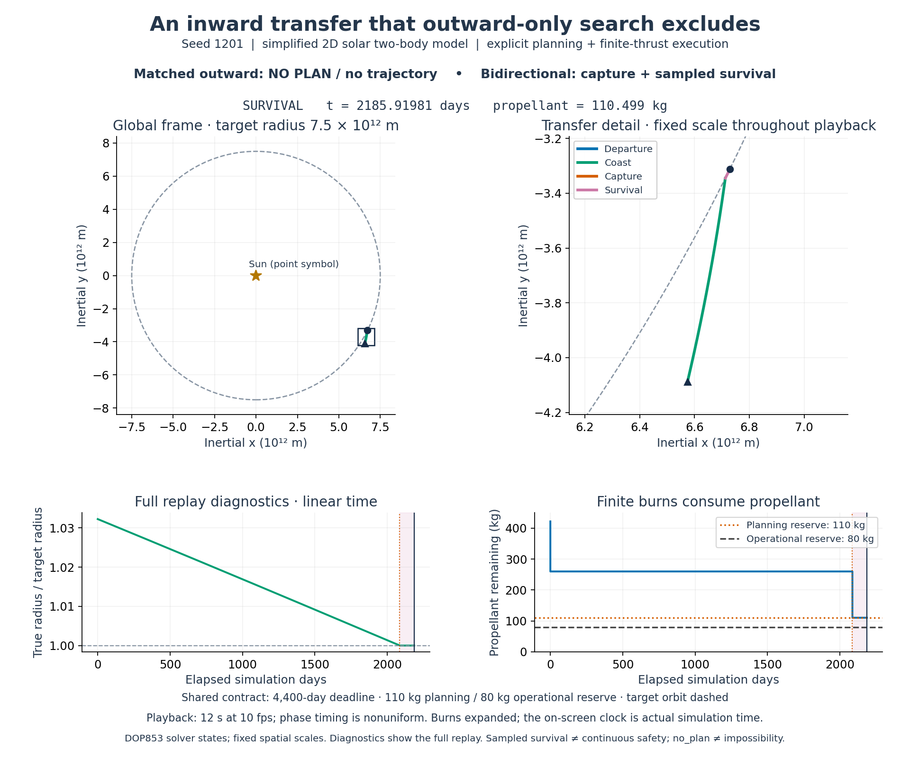

# A recorded inward transfer, replayed with the real simulator



The demonstration explains one exterior-start holdout task. `matched_outward` records **no plan and no numerical mission execution**. The bidirectional method records capture and sampled survival. Neither outcome establishes global feasibility, optimality or arbitrary-condition robustness. The whole 24-task comparison remains 11/24 versus 24/24; this selected replay adds no benchmark trials.

## Evidence and reproduction

Source base: [`1ae4745b7d02deac7ff17c3d34b923d6d3c55c0f`](https://github.com/Sean-ZhiXin-Li/spacecraft-ai-controller/commit/1ae4745b7d02deac7ff17c3d34b923d6d3c55c0f), which includes the October research published at `ff4d062`. Inputs are the original [configuration](../development_results/multiregime_transfer_2026-10-23_holdout/configuration.json), [raw records](../development_results/multiregime_transfer_2026-10-23_holdout/runs.jsonl), summary, comparison, implementation snapshot and both hash manifests in that same directory. Only seed **1201**, methods `matched_outward` and `bidirectional`, is selected. All recorded states, observations, constraints and the saved plan are retained; no new bidirectional optimization is performed.

From the repository root, with Python 3.10+, NumPy, SciPy, Matplotlib and Pillow:

```bash
python -m scripts.render_orbital_transfer_demo
# Check hashes and saved replay metrics without another simulation or render:
python -m scripts.render_orbital_transfer_demo --verify-only
python -m unittest -q Tests.test_orbital_transfer_demo
```

The renderer writes only `docs/assets/orbital_transfer_1201/`. It does not invoke the research campaign/report generators or edit frozen results. Existing files in this dedicated demo directory are regenerated by the rendering command. Output image bytes can depend on library/font versions; the [manifest](assets/orbital_transfer_1201/provenance.json) records versions, source identities, command, tolerances, timing and output hashes. Its input records come solely from the public repository.

## Numerical recording and checks

[`render_orbital_transfer_demo.py`](../scripts/render_orbital_transfer_demo.py) calls the existing `multiregime_transfer_research.execute` with the saved plan, state, seed, actual thrust scale and 4,400-day deadline. A scoped recorder temporarily wraps the existing model propagator. It requests DOP853 dense output while preserving controls, events, tolerances, measurement bias, guidance updates and success predicates. The original function is restored on exit. Native integration nodes and additional evaluations of that solver-provided polynomial supply the history; no line is fitted between the initial and final states and no analytic Kepler arc substitutes for finite burns.

The recording uses the original solar two-body model, inertial Cartesian state `[x, y, vx, vy, mass]`, target radius `7.5e12 m`, nominal thrust 2,000 N, actual scale `0.7623464788066345`, 450 s specific impulse, 722/300 kg wet/dry mass and 100 s guidance intervals. DOP853 retains `rtol=1e-11`, `atol=[0.01 m, 0.01 m, 1e-7 m/s, 1e-7 m/s, 1e-7 kg]`. Planning reserve is 110 kg and operational reserve 80 kg. The outward-only search is checked once under those same constraints and returns no plan; no failed trajectory is invented.

Replay crossing/final Cartesian states, completion time, propellant, eccentricity, relative radius error, sampled survival error and all outcome flags are checked against the original record before any rendering. Allowed differences are 1 m in position, `1e-5 m/s` in velocity, `1e-6 kg` in mass/propellant, `1e-6 days` in completion time, `1e-9` in eccentricity and `1e-10` in radius-error metrics. These are tight numerical reproducibility checks, not physical uncertainty bounds; the time allowance is 0.0864 s, smaller than a guidance update. Actual differences are saved in the manifest; rendering aborts if a check fails.

The original byte manifests are checked before replay. Checkout line-ending transformations can affect hashes: only exact original bytes or an explicitly recorded LF/CRLF equivalent are accepted, alongside committed-source identities. The manifest discloses the matching byte form and checkout/blob hashes. No experimental file or historical manifest is rewritten to obtain a match.

## Reading the visual

- The full frame uses the Sun at the origin and the target orbit at its correct coordinate radius. The Sun is a **point symbol**, not a radius drawn to scale. Axes use `10¹² m`; equal aspect preserves geometry. A rectangle identifies the detail view, whose scale also remains fixed throughout playback.
- Phase colors identify departure, coast, capture and the 100-day unpowered survival check. Very short burns have negligible spatial extent at this solar scale; their mass changes remain visible in the diagnostics. The diagnostic horizontal axis is linear simulation days, not playback time. The final 100 days are shaded; the vertical dotted line identifies capture completion.
- The animation has **120 frames at 10 fps, 12 seconds total**. Departure receives 1.5 seconds of playback, coast 7.5, capture 1 and survival 2. This is deliberately **nonuniform phase timing**, not a constant acceleration factor. The on-screen day counter always shows actual simulation time. Full-run diagnostic curves are a reference, with a moving current-time cursor.
- [trajectory.csv](assets/orbital_transfer_1201/trajectory.csv) contains strictly increasing seconds, SI state values, phase and animation-frame index (`-1` for non-frame samples). Sampling combines native solver nodes, grids no coarser than 10 s during burns, 2 days during coast and 1 day during survival, plus every actual frame time. All samples are solver states; no arbitrary smoothing is applied.

Captured means converged guidance, eccentricity `<0.001`, relative radius error `≤0.0025`, and completion within 4,400 days. Seed 1201 completes at 2,085.91981086 days with 110.49875760 kg propellant remaining. Survival is the original check at **101 samples over 100 days**, not a continuous-time guarantee. This remains explicit model-based control in a simplified 2D solar simulation, not an RL policy, a physically qualified mission, or flight-ready GNC.
